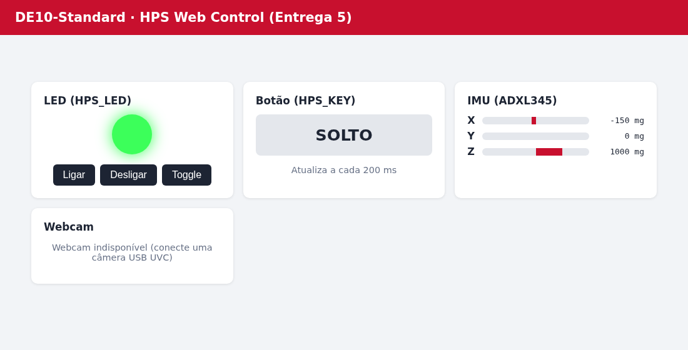

# Entrega 5 – DE10-Standard HPS Web Server

Embedded web server for the **Terasic DE10-Standard (Cyclone V SoC)** used in
[Embarcados Avançados – Entrega 5](https://insper.github.io/Embarcados-Avancados/Entrega-5).
The web page lets you:

| Rubric | Feature | Where |
|---|---|---|
| C | Turn the HPS LED (`HPS_LED`) on/off/toggle from a web button | `hwctl/hwctl.c`, `server.py` |
| C | Live status of the HPS user button (`HPS_KEY`) | same |
| Extra | Live ADXL345 IMU (G-sensor) readings | `hwctl/hwctl.c` (`/dev/i2c-0`) |
| B | Buildroot overlay + `/etc/init.d` script that starts everything at boot | `buildroot/` |
| A | USB webcam image shown on the page (`/camera.jpg`, via `fswebcam`) | `server.py`, `buildroot/kernel-webcam.config` |



## Architecture

```
 Browser ──HTTP:80──▶ server.py (Python 3, stdlib only) ──UNIX socket /tmp/entrega5.socket──▶ hwctl (C)
                            │                                                                │
                            └── fswebcam → /dev/video0 (webcam)            /dev/mem (GPIO1) ─┤ LED / KEY
                                                                          /dev/i2c-0 (0x53) ─┘ ADXL345
```

* **`hwctl`** (C) maps the HPS GPIO1 registers (`0xFF709000`) with `mmap(/dev/mem)`, exactly
  like `hps_gpio` from the DE10 System CD: LED = GPIO1 bit 24, KEY = GPIO1 bit 25 (active low).
  It also reads the ADXL345 the same way as `hps_gsensor`. It listens on a UNIX socket with a
  text protocol: `LED ON|OFF|TOGGLE`, `STATUS` → `LED=1 BTN=0 IMU=x,y,z`, `PING`.
* **`server.py`** serves the page and a JSON API: `GET /api/status`, `POST /api/led`
  (`{"state":"on|off|toggle"}`), `GET /camera.jpg`.
* `hwctl` is linked **statically**, so it runs on the Buildroot rootfs no matter which glibc it has.
  A prebuilt binary is already in `buildroot/overlay/usr/bin/hwctl`.

## Repository layout

```
hwctl/                         C hardware daemon + Makefile (cross-compile)
buildroot/
  apply.sh                     configures an existing buildroot tree to use this project
  entrega5.config              Buildroot config fragment (python3, fswebcam, dropbear)
  kernel-webcam.config         kernel options for a UVC webcam (rubric A)
  overlay/                     Root filesystem overlay (copied into the image by Buildroot)
    etc/init.d/S41network-entrega5   eth0: DHCP, falls back to 169.254.0.13
    etc/init.d/S90webserver          starts hwctl + server.py at boot
    opt/entrega5/server.py           web server
    opt/entrega5/static/index.html   web page
    usr/bin/hwctl                    prebuilt ARM binary
scripts/run-mock.sh            run everything on a PC with emulated hardware
```

## Testing on the board

Prerequisite: the SD card from the class tutorials (preloader/u-boot, kernel, dtb, Buildroot rootfs),
following the same configuration as [Tutorial-HPS-Buildroot](https://insper.github.io/Embarcados-Avancados/Tutorial-HPS-Buildroot).

### Option 1 – full Buildroot image (rubric B, recommended)

```bash
git clone <this repo> entrega5
cd buildroot                       # your buildroot tree, already configured as in class
../entrega5/buildroot/apply.sh "$PWD"   # builds hwctl, sets overlay + packages
make ARCH=arm all -j$(nproc)
```

`apply.sh` rebuilds `hwctl` if `arm-linux-gnueabihf-gcc` is in the `PATH` (same toolchain as class);
otherwise it uses the prebuilt `overlay/usr/bin/hwctl`.

Extract `output/images/rootfs.tar` to the rootfs partition of the SD card as in
[info-SDcard](https://insper.github.io/Embarcados-Avancados/info-SDcard), boot the board, and open
`http://<board-ip>/` in a browser. The IP is printed at boot (`Configuring eth0: ...`) or run `ifconfig`
on the serial console. Without a DHCP server the board uses `169.254.0.13`
(set your PC to `169.254.0.x / 255.255.0.0`).

### Option 2 – quick test on an existing image (needs python3 on the board)

```bash
scp buildroot/overlay/usr/bin/hwctl root@<board-ip>:/usr/bin/
scp -r buildroot/overlay/opt/entrega5 root@<board-ip>:/opt/
ssh root@<board-ip>
hwctl &                                  # must run as root (/dev/mem)
python3 /opt/entrega5/server.py          # http://<board-ip>/
```

Or copy the same files to the SD card rootfs partition from your PC.

### What to check

1. Click **Ligar / Desligar / Toggle** → the `HPS LED` (green LED near the HPS button) follows.
2. Press and hold **HPS KEY** → the card changes to **PRESSIONADO**.
3. Tilt the board → the IMU bars move (Z ≈ 1000 mg when flat).
4. Plug a USB webcam (UVC) → the image updates about twice per second.
   This needs the kernel options in `buildroot/kernel-webcam.config`; rebuild `zImage` if your kernel
   doesn't have them (`ls /dev/video0` on the board to check).
5. Reboot → the server starts by itself (`/etc/init.d/S90webserver`; restart it with `/etc/init.d/S90webserver restart`).


## Running on a PC (no board)

```bash
./scripts/run-mock.sh          # open http://localhost:8080
touch /tmp/entrega5_btn        # "press" the button
rm /tmp/entrega5_btn           # release
```

## Rebuilding hwctl

```bash
cd hwctl
make install        # arm-linux-gnueabihf-gcc, static, installs into buildroot/overlay/usr/bin
```

Debug on the board without the browser:

```bash
python3 -c "import socket;s=socket.socket(socket.AF_UNIX);s.connect('/tmp/entrega5.socket');s.send(b'STATUS\n');print(s.recv(99))"
```
